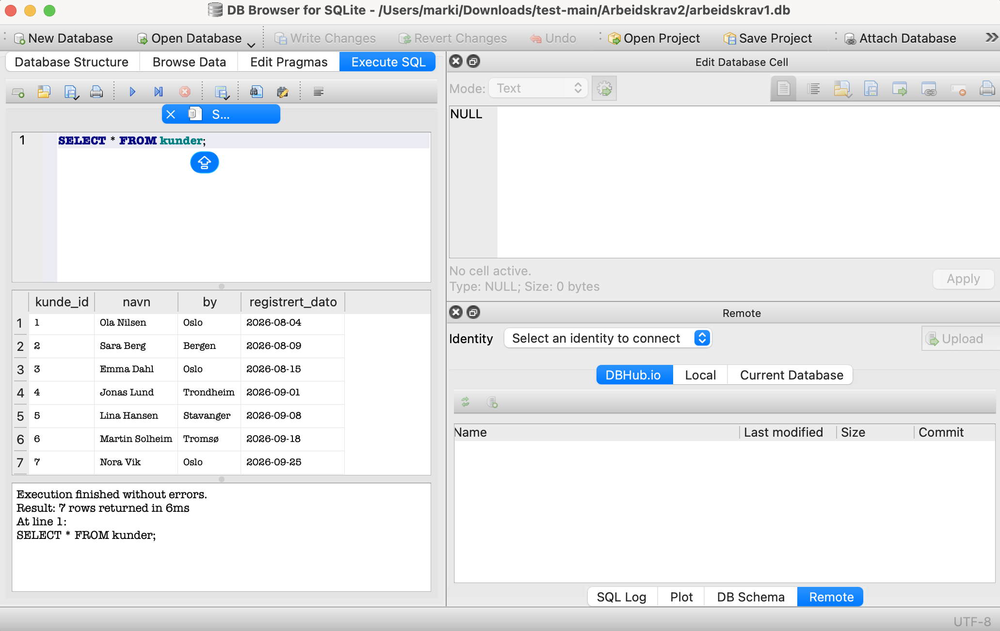
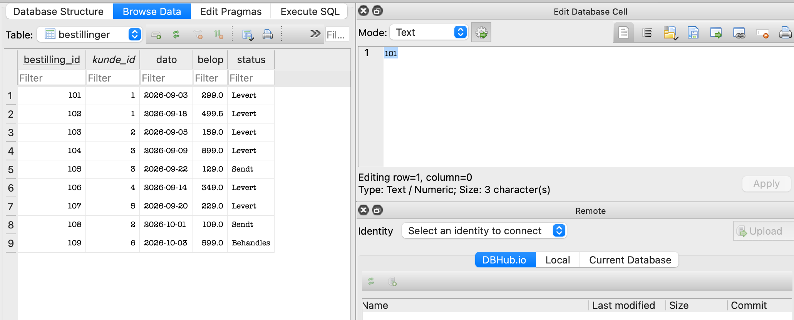
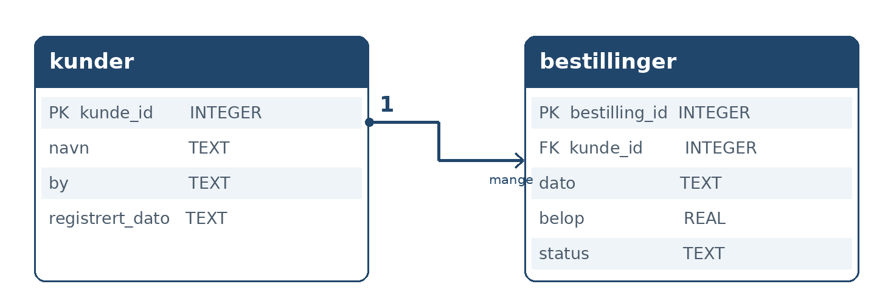

# **Arbeidskrav 1 – Innføring i dataanalyse**

For denne arbeidskravet har jeg brukt SQLite og to tabeller: `kunder` og `bestillinger`.
Alle kundene, bestillingene og beløpene er **fiktive**. Dette er data jeg har funnet på nett og funnet på selv (VED BRUK AV CHATGPT)

I tillegg har jeg valgt å lagre alt i README filen, blant annet beskrivelse av SQL spørringer og litt bevis. 

## How to Run the Project

1. Install Python 3. SQLite is included with Python through the `sqlite3` module.
2. Open the Terminal/PowerShell in the project folder.
3. Check the SQLite version:

   ```bash
   python -c "import sqlite3; print(sqlite3.sqlite_version)"
   ```

4. Create the database and import the CSV files:

   ```bash
   python3 database.py
   ```

   On some Windows computers, you may need to use `py` instead of `python`.


## **Screenshots**
### SQLite Installation
The screenshot below shows that SQLite is installed and working.






